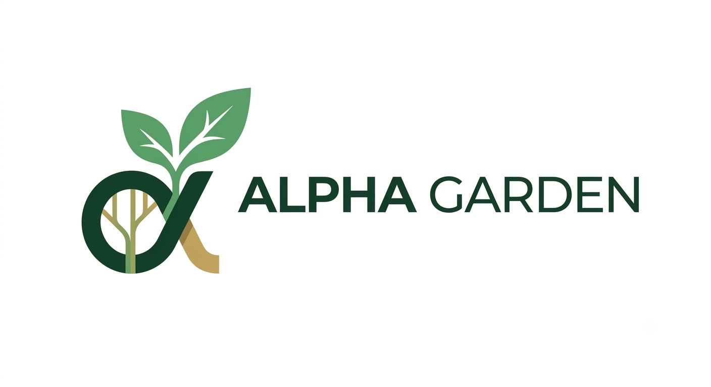
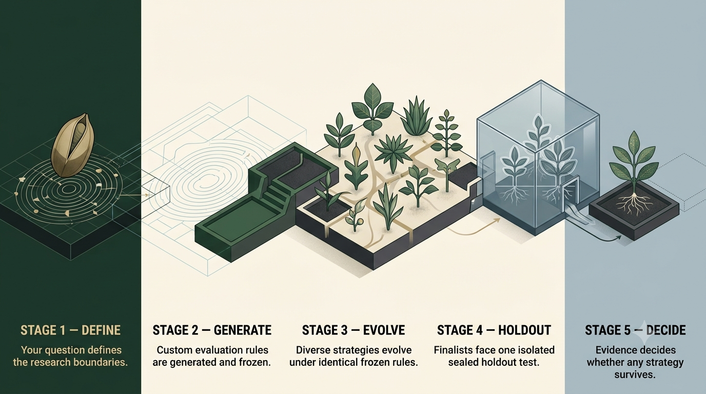

<h1 align="center">
  
</h1>

<p align="center">
  <strong>培育想法，检验策略，让证据作出决定。</strong>
</p>

<p align="center">
  一个证据优先的策略进化实验室。
</p>

<p align="center">
  <a href="README.md">English</a> · 简体中文
</p>

Alpha Garden 是对 [CogAlpha：通过 LLM 驱动的代码进化进行认知型 Alpha
挖掘](https://arxiv.org/abs/2511.18850) 这一研究方向的现代化、面向 Agent
的复现。它保留了原工作的核心思想：让 LLM 创建可执行策略，从历代评估结果中
学习，并通过进化产生更好的候选；同时围绕隔离的 Agent 任务、可复现实验、
确定性门槛和严格的留出集纪律重新构建整个流程。

本仓库以 `evolve-trading-strategy` Agent Skill 的形式发布。它可以把用户的交易
灵感或研究资料库转化为经过严谨检验的单标的时间序列策略。事务型 SQLite 队列
负责协调通用 Agent Worker，自动生成的只读监控页面展示实时进度，确定性验证则
决定哪些候选能够存活。最终交付物包括可运行的策略代码、完整的实验轨迹和专业
PDF 研究报告，而不是一份不透明的 LLM 建议清单。



首个版本聚焦分钟级及以上周期的 OHLCV K 线。目前不进行横截面选股，也不会
下达实盘订单。

## 为什么选择 Alpha Garden

CogAlpha 表明：与其把 LLM 当作一次性的公式生成器，不如让它成为进化研究系统
的一部分，这样能够更有效地挖掘 Alpha。Alpha Garden 将这一洞见带入现代 Agent
运行环境：

- **面向 Agent 的执行方式：** 候选创建、批判、修复和综合都以隔离任务运行，
  并具有明确的输入输出契约。
- **证据拥有最终裁决权：** 编译、泄漏检查、回测、交易成本、走步验证和风险
  门槛的优先级高于语义判断。
- **无污染进化：** Worker 可以学习经过批准的前代证据，但看不到同代其他任务
  的结果，也无法访问密封的最终留出集。
- **从设计上保证可复现：** 实验规格、数据来源、依赖版本、Prompt、代码、指标
  和选择事件全部记录在 SQLite 中。
- **允许诚实地停止：** 系统可以得出“没有候选合格”的结论，不会为了迎合 Prompt
  而凭空制造成功策略。

这是概念和工程层面的复现，并不声称拥有相同的源代码或完全一致的实验范围。
CogAlpha 评估的是股票横截面因子；Alpha Garden 当前专注于单标的时间序列策略，
并进一步强化了实验隔离、实时监控、走步验证和密封测试控制。

## CogAlpha 实验结果带来的启发

以下均为 **CogAlpha 论文报告的结果**，不是本仓库运行得到的结果。这些数据解释
了为什么基于代码、迭代式的 Agent 搜索值得被复现和扩展。

在 CSI300、10 日预测周期上，论文将 CogAlpha 与 21 个机器学习、深度学习、
Alpha 因子库、自动挖掘方法及独立 LLM 基线进行了比较：

| 方法 | IC | RankIC | ICIR | RankICIR | AER | IR |
| --- | ---: | ---: | ---: | ---: | ---: | ---: |
| LightGBM | 0.0269 | 0.0412 | 0.2811 | 0.3327 | 0.0878 | 1.0980 |
| Alpha158 | 0.0358 | 0.0402 | 0.2737 | 0.2866 | 0.0946 | 0.8556 |
| 独立 gpt-oss-120B | 0.0300 | 0.0318 | 0.2501 | 0.2595 | 0.0789 | 0.8015 |
| **CogAlpha + gpt-oss-120B** | **0.0591** | **0.0814** | **0.3410** | **0.4350** | **0.1639** | **1.8999** |

相对于论文完整表格中各项指标最强的基线，CogAlpha 报告的 IC 约提升 **65%**、
RankIC 约提升 **98%**、AER 约提升 **37%**、IR 约提升 **44%**。它的 RankICIR
与随机森林接近（0.4350 对 0.4385），这也提醒我们应检查所有指标，而不是只展示
一个亮眼数字。

论文的消融实验也支持将 CogAlpha 理解为一个完整系统：

| 配置 | IC | RankIC | ICIR | RankICIR | AER | IR |
| --- | ---: | ---: | ---: | ---: | ---: | ---: |
| 基础 Agent | 0.0300 | 0.0318 | 0.2501 | 0.2595 | 0.0789 | 0.8015 |
| + 思维进化 | 0.0219 | 0.0420 | 0.1932 | 0.3322 | 0.0808 | 0.8999 |
| + 自适应生成 | 0.0315 | 0.0491 | 0.2568 | 0.3583 | 0.0825 | 1.0145 |
| + 多样化引导 | 0.0414 | 0.0501 | 0.3239 | 0.3599 | 0.1245 | 1.4668 |
| **+ 七层 Agent 层级（CogAlpha）** | **0.0591** | **0.0814** | **0.3410** | **0.4350** | **0.1639** | **1.8999** |

论文报告的 Ridge 结果还覆盖了不同市场和预测周期：

| 数据集 / 预测周期 | IC | RankIC | ICIR | RankICIR |
| --- | ---: | ---: | ---: | ---: |
| CSI300 / 10 日 | 0.0539 | 0.0714 | 0.3471 | 0.4380 |
| CSI300 / 30 日 | 0.0815 | 0.1069 | 0.4408 | 0.5403 |
| CSI500 / 10 日 | 0.0455 | 0.0738 | 0.2903 | 0.4752 |
| S&P500 / 10 日 | 0.0217 | 0.0226 | 0.2189 | 0.1726 |
| HSI / 10 日 | 0.0327 | 0.0400 | 0.1903 | 0.2330 |
| HSCI / 10 日 | 0.0562 | 0.0495 | 0.5396 | 0.4394 |

这些数值来自论文的表 1、表 3 和表 5。Alpha Garden 不会将它们作为自身的基准
结果。任何 Alpha Garden 实验都必须报告自己的数据区间、成本、数据划分、候选
预算和密封测试结果，之后才能负责任地比较两种方法。

## 研究流程

1. 访谈用户并冻结机器可读的实验规格。
2. 生成针对当前问题的只读进化监控页面。
3. 获取并审计符合时间点要求的市场数据。
4. 冻结执行时序、成本、验证划分、门槛和搜索预算。
5. 从用户想法和受控的创新方向中生成多样化候选家族。
6. 调度隔离的 Agent 任务来创建、变异、交叉、修复或挑战候选。
7. 按照确定性契约编译和回测每个候选。
8. 根据走步验证证据繁育下一代，同时保持最终留出集密封。
9. 冻结最终候选，只打开一次留出集，并发布代码和可审计报告——即使最终没有
   策略通过也同样如此。

## 仓库结构

```text
skills/
└── evolve-trading-strategy/
    ├── SKILL.md
    ├── agents/
    ├── assets/
    ├── references/
    ├── scripts/
    └── tests/
```

## 安装

最简单的方式是把仓库地址直接交给你的 Agent：

```text
请从以下仓库安装 evolve-trading-strategy skill：
https://github.com/YoungY620/Alpha-Garden.git
```

Agent 可以克隆仓库、找到嵌套的 Skill，并将其安装到当前 Agent Host 对应的
Skills 目录。

如需手动安装，可将嵌套的 Skill 文件夹复制到 Agent Host 使用的 Skills 目录：

```bash
test -n "$SKILLS_DIR"
mkdir -p "$SKILLS_DIR"
cp -R skills/evolve-trading-strategy "$SKILLS_DIR/"
```

可以用下面的 Prompt 调用：

```text
使用 $evolve-trading-strategy，将这些研究笔记转化为经过验证的单标的策略，
并生成 PDF 报告。
```

运行附带脚本前，请将确定性研究与报告依赖安装到共享、隔离的用户缓存运行环境。
需要 Python 3.11 至 3.14：

```bash
python3 skills/evolve-trading-strategy/scripts/bootstrap_runtime.py
```

每次实验都应冻结解析后的具体依赖版本。依赖发生变化时，应创建新的实验版本。

## 发布前验证

```bash
python3 skills/evolve-trading-strategy/scripts/audit_release.py .
python3 skills/evolve-trading-strategy/tests/run_smoke_tests.py
```

发布审计会拒绝特定机器路径、IP 地址、电子邮件、凭据、Token 以及其他疑似秘密。
两条命令均通过前，请勿发布。

本项目只生成研究产物，不构成投资建议，也不承诺未来收益。
